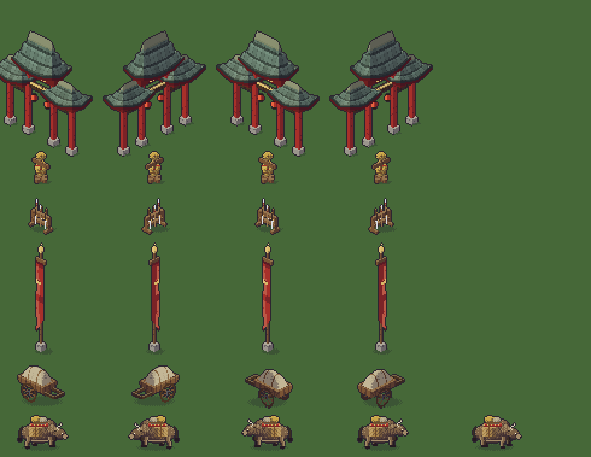
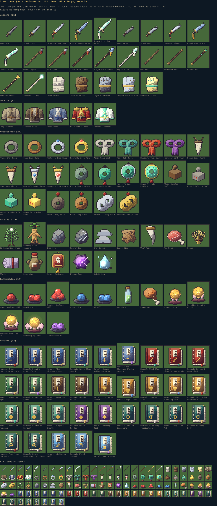

# Adobe sprite trial and the sprite asset pipeline

Date: 2026-10-26. Branch `art-pipeline`. Nothing here is wired into the game; assets, loader, gallery and this report only.

## Verdict (short)

1. **The Adobe connector could not produce a single sprite candidate in this session.** It exposes image *processing* tools (background removal, vectorise, crop and resize, adjustments, masks, generative *expand*) but no text-to-image or Firefly generation tool; the connector's own init notes say generation is "not available in this environment". On top of that, the cloud sandbox blocked every way of getting one of our pictures into the tools (details below). So: **zero Adobe outputs were seen, none were imported, and I make no claim about how good they would have been.**
2. What I can say honestly: even if generation were available, nothing in the connector can enforce what this game needs (hard 0/255 alpha, a fixed palette, a true 2:1 ground diamond, the same object in four facings). Those would all have to be done by the importer afterwards, and the importer's own self-test shows that downscaling a large picture to 28 px loses thin parts.
3. **Recommendation: do not rely on Adobe output directly. Use the procedural generators (`art/sectprops.ts`, delivered and tested) for the first batch.** If you want to keep exploring Adobe, use Firefly or Photoshop in Adobe's own apps as *concept reference only*, and feed any exported PNG through `scripts/art/import-sprite.ts`. See "How to continue the Adobe trial" for the two settings that must change.
4. Before shipping any Adobe-generated content, **check Adobe's terms for commercial use of generated content** (Firefly generations, Stock comps and anything produced with their tools). Nothing from Adobe is in this repository.

## What was delivered

| Part | Where | Status |
| --- | --- | --- |
| Procedural sect gate, training dummy, weapon rack, banner (tintable), handcart, pack ox | `packages/client/src/art/sectprops.ts` | 6 of 6 inside their target height range, 4 facings each, ox has 2 walk frames |
| Target heights for them (new block, `scale.ts` untouched) | `SECT_TARGETS`, `OX_LENGTH` in `sectprops.ts` | tested in `sectprops.test.ts` (35 tests) |
| Import pipeline (pure steps) | `packages/client/src/art/spriteimport.ts` + `png.ts` | 23 tests; no new dependency (PNG codec uses the platform's compression streams) |
| Import script | `scripts/art/import-sprite.ts` (+ `build-palette.ts`, `dump-sectprops.ts`) | works end to end |
| Palette derived from the game art | `packages/client/src/assets/palette.json` | 96 colours, sampled from every generator |
| Runtime loader and registry | `packages/client/src/art/imported.ts` | `loadImportedSprite`, `importedSprites.get(id, dir)`, mirroring of derived facings incl. row spans; 4 tests for the pure parts |
| Dev gallery | `packages/client/assets.html` + `src/assetGallery.ts` | renders everything, pass or fail per asset; screenshots in `docs/notes/img/` |
| Inventory item icons, all 112 items of `data/items.ts` | `packages/client/src/art/itemicons.ts`, `itemmisc.ts`, `itemkit.ts` | 40 x 40 px, drawn in code; 9 tests; shown in the gallery (see "Item icons") |
| One self-test import | `packages/client/src/assets/sprites/selftest_pack_ox*` | from a stand-in picture, **not Adobe art**; exercises loader and gallery |

Totals: new PNGs under `docs/notes/img` and `assets` are about 0.7 MB, the largest is 187 KB (limit 300 KB each, 3 MB together). No source files, no secrets.

Run the gallery: `npx vite packages/client --port 5201` then open `http://localhost:5201/assets.html` (dev only; the production build still has just `index.html`). Optional `?zoom=2` and `?marks=0`.

Images: `docs/notes/img/contact-sheet.png` (all six procedural assets, four facings, ox frame 2), `gallery-zoom2-a.png` and `gallery-zoom2-b.png` (the gallery page at zoom 2), `ox-procedural.png` and `ox-selftest-import.png` (zoom 3, procedural against the importer's output).



## Adobe: what was available and what happened

### Tools actually present

After `adobe_mandatory_init` (called first, as required) the gateway offered:

- **Images (Photoshop / Lightroom):** `image_remove_background`, `image_vectorize` (raster to SVG), `image_crop_and_resize`, `image_crop_to_bounds`, `image_generative_expand` (outpainting), `image_fill_area` (solid colour fill under a mask), `image_select_subject`, `image_select_by_prompt`, `image_invert_selection`, `image_apply_adjustments` and the single-purpose adjustment tools, grain, noise, blur, halftone, presets, auto tone and straighten.
- **Assets:** `asset_create_folders`, `asset_initialize_file_upload` / `asset_finalize_file_upload`, `asset_add_file` (file picker), `asset_search` (Creative Cloud, Stock, Lightroom, Firefly generations), `asset_license_and_download_stock`, `asset_preview_file`, `asset_inline_preview`, `asset_copy_assets`, sharing tools.
- **Other:** Boards (`boards_*`, `create_firefly_board`), Express, fonts, PDF, video, InDesign tools.
- **Not present:** any text-to-image or Firefly generation tool. A ToolSearch for "firefly generate image text to image" returned only editing tools, and the init document states that image generation, generative fill and text-to-image are not available (only `image_generative_expand` is).

### Tools used and every setting

| # | Call | Settings | Result |
| --- | --- | --- | --- |
| 1 | `adobe_mandatory_init` | none | ok |
| 2 | `asset_create_folders` | name `Murim Apocalypse - sprite trial` | created folder `urn:aaid:sc:AP:d3bfc26e-cfd9-44d8-a931-8d07658a753b` |
| 3 | `asset_initialize_file_upload` x2 | paths `Murim Apocalypse - sprite trial/src_ox_dir0.png` (63926 B) and `.../src_gate_axis0.png` (105608 B), `image/png` | returned upload links; **the PUT to `at.adobe.com` was refused by the sandbox network policy (HTTP 403 from the egress proxy)**, uploads never finalised |
| 4 | `image_remove_background` x3 | `imageURI` = raw.githubusercontent.com URL of the pushed stand-in picture; the same file on cdn.jsdelivr.net; an Adobe Stock thumbnail on t3.ftcdn.net | all three rejected: `URL domain not whitelisted` |
| 5 | `image_vectorize` x2 | raw.githubusercontent.com URL; Stock thumbnail | both rejected, same reason |
| 6 | `asset_inline_preview` x1 | Stock thumbnail URL | rejected: `presignedUrl host not allowed` |
| 7 | `asset_search` | scope `StockAsset`, query `isometric pixel art ox with cart, game sprite`, `pricing: free`, limit 6 | six results, none usable as sprite art (a carriage photo, a pixel-art tree, a pixel-art computer, a road roller, a man with a cart, sled dogs); **nothing was licensed or downloaded** |
| 8 | `asset_search` | scope `CCAsset`, `assetClass: directory`, query `Murim Apocalypse - sprite trial` | found two empty folders (see hygiene) |

No generation prompts were run because no generation tool exists. Prompts that were prepared for a manual Firefly run are listed at the end; they were **not** used.

Why the tools could not be exercised: they only fetch images from Adobe-controlled storage, and getting our files there needs either `asset_add_file` (an interactive picker, not available in a cloud session) or an upload to `at.adobe.com`, which this environment's network policy denies. Public mirrors of the same picture (GitHub raw, a CDN) are refused by the tools' own domain whitelist. Nothing was worked around beyond those attempts.

### Account hygiene

Only creation happened. Adobe account now contains **two empty folders both named `Murim Apocalypse - sprite trial`** (`d3bfc26e-...` from the folder call, `6389a303-...` created when the upload path was resolved). Nothing existing was deleted, moved, shared, renamed or overwritten, no link was created, and no Stock asset was licensed. I did not delete the duplicate: the rule was never to delete, so please remove the extra empty folder yourself if you like. No tokens or secrets are in the repository.

### Per-criterion assessment

"Adobe" means the connector as it exists in this session. Entries marked *documented* come from the tools' own descriptions, not from anything I observed; I observed no Adobe output.

| Criterion | Adobe connector | Procedural (`sectprops.ts`) | Importer on a clean stand-in picture |
| --- | --- | --- | --- |
| Pixel cleanliness (hard edges, alpha 0 or 255) | Not observed. *Documented:* background removal returns a smooth cutout PNG, vectorise returns SVG, resizing is a photographic resample. All of it would need thresholding afterwards. | Pass. Tests check every pixel is opaque except the small baked ground shadow. | Pass after the pipeline: 0 translucent pixels in the self-test output. |
| Palette fit with the existing art | No palette control exists (adjustments are continuous). | Pass by construction: same ramps, `INK_SOFT` outline, same lacquer and gold. | Pass: every pixel is one of the 96 palette colours (35 used). Fit is only as good as the nearest-colour snap. |
| Isometric angle (2:1 ground diamond) | Not controllable. Nothing in the toolset sets geometry. | Pass by construction (Scene3D uses the game's projection); the gallery draws each footprint diamond under the anchor. | Can only be *measured* (`groundEdgeSlopes`), not corrected. Not meaningful for the ox. |
| Readability at 16 to 32 px | Not observed. | Good: drawn at final size, the ox, cart, rack and banner read at zoom 1. The dummy and the weapon rack are the weakest. | **Weak.** In the self-test the thin legs and the horns shrink to stubs at 28 px (`img/ox-selftest-import.png` against `img/ox-procedural.png`). Any large source will have the same problem. |
| Consistency between directions | Not testable; each call is independent, so four facings of one object would come out as four different objects. | Pass: one generator, shared parameters, mirrors for 1 and 2. | Per-facing pictures are imported separately; only mirrored facings are consistent by construction. |
| Effort per asset | Not measurable (no output). | All six assets and tests in one working session, including the tuning loop; a new variant is a parameter. | One command per facing, a minute per run, but the cost is in preparing a usable source picture. |

### What the self-test taught (observed)

The importer was run end to end on a stand-in picture (the procedural ox upscaled 10x with bilinear smoothing, a gradient backdrop and a baked soft shadow). It found a real bug on its first run: the soft shadow stayed outside the flood-fill tolerance and became a pale blob glued to the feet, hiding the legs. That is fixed (darker, equally neutral pixels touching the backdrop are cleared, with a switch and a test), and the 'feet' anchor now uses the bounds centre. This is the kind of defect an AI render with a drop shadow will have, so it is worth knowing about. It also showed the thin-parts problem above. The stand-in is committed under `docs/notes/img/trial/` as evidence; `provenance.tool` of the imported asset says "pipeline self-test (no Adobe involved)".

## Item icons (added after the Adobe trial)

Because Adobe could not generate anything, the inventory icons were drawn in code too: one 40 x 40 pixel icon for each of the 112 entries in `data/items.ts` (25 weapons, 5 outfits, 24 accessories, 14 materials, 12 consumables, 32 manuals). No web assets were copied; the shapes are original and follow common pixel-art icon practice (1 px dark outline, light from the upper left, 3 to 4 tone ramps, a few highlight pixels).

- `genItemIcon(def, rarity?)` returns `{ pb, glow }` (pure, node-testable); `itemIconCanvas(def)` is the cached DOM bridge.
- **Wired into the UI:** `ui/widgets/itemSlot.ts` shows the pixel icon in every item slot (inventory, equipment slots, grids, shop, reward rows) and in the item tooltip header (`TipModel.item`); weapons also get the rarity shine of their stack. The icon is shown at exactly 1:1 with `image-rendering: pixelated`, so every slot has to hold 40 px inside its 2 px border: the small slot grew from 36 to 44 px (`.slot-sm` in `styles/components.css`) and a test fails if any slot size gets smaller than that. Skills and small chips still use the vector icons from `ui/icons.ts`. CSS is `.slot-px`, `.px-icon` and `.tip-px`. `uislots.html` (dev only) renders the real widgets; screenshot: `docs/notes/img/ui-slots.png`.
- **Weapons** reuse `drawWeapon` from the in-world renderer at 45 degrees, so tier materials, tassels and jade tips match the figure holding the weapon; fists use `fistGear` for cloth wraps, leather, steel and gold-and-jade gauntlets. Because the in-world weapons are small, tier 1 swords and blades are small in the 40 px frame (about 14 to 25 px long); spears and staffs fill the frame.
- **Outfits** (five tiers: hemp, leather vest, cloud robe, silk battle robe, immortal garment), **accessories** (ring, silk sash, bone charm, jade pendant, scholar's seal, lucky coin; metal, gem and glow change by tier), **materials** and **consumables** take their colours from `def.color` where the data names one. Pills show more pills per tier, breakthrough pills sit on a lotus with more petals and glow per tier.
- **Manuals** are thread-bound books: cover colour and gold emblem by school (nine schools), one gold diamond per tier, and a ribbon colour and title marks hashed from the skill id so every manual differs.
- Known weak spots: the iron ingot reads as two grey wedges, the stacked tier 3 and 4 lucky coins are lumpy, and the silk sash looks like a bow rather than a belt.
- Checks: every item has an icon, only 0 or 255 alpha in the colour layer (glow may be translucent), every edge pixel is the ink colour, all 112 pictures are different, output is deterministic.

Images: `docs/notes/img/item-icons.png` (the gallery section at zoom 3, plus all icons at zoom 1) and `docs/notes/img/item-icons-sheet.png` (plain contact sheet). Gallery: `assets.html` shows them under "Item icons" (`?izoom=2` to change the zoom, `?items=0` to hide). Quick dump without a browser: `npx tsx scripts/art/dump-itemicons.ts out.png 3 [weapon,outfit,...]`.



## The pipeline

```
npx tsx scripts/art/import-sprite.ts --src in.png --id pack_ox --dir 0 --height 27 \
    --tool "Adobe Firefly" --prompt "..." [--footprint 1x1] [--method area|nearest] \
    [--anchor feet|footprint|X,Y] [--bg auto|none|#rrggbb] [--tolerance 40] [--no-outline] \
    [--derive 1=0:flip,2=3:flip] [--apex-offset N] [--out dir]
```

Steps: background removal (flood fill from the border, shadows included, an already transparent border is kept), crop, resize to the height (`area` for painted or photographic sources, `nearest` for pixel art at a bigger scale), alpha forced to 0 or 255, specks removed, colours snapped to `palette.json`, 1 px `INK` outline, anchor and row spans. Output: `assets/sprites/<id>/<dir>.png` and `assets/sprites/<id>.json` (`id`, `w`, `h`, `ax`, `ay`, `top`, `footprint {w, d}`, `heightPx`, `dirs`, `provenance {tool, prompt, date}`). `dirs` maps "0".."3" (0 SE, 1 SW, 2 NW, 3 NE) to either `{file}` or `{from, flip}`; a facing can carry its own `w, h, ax, ay, top`. The script refuses PNGs over 300 KB, prints colours, translucent pixels, size and the ground-edge slopes.

Rebuild the palette after the art changes: `npx tsx scripts/art/build-palette.ts 96`.

Limits worth knowing:

- `heightPx` is measured from the anchor to the top pixel. For a deep footprint (the 4 x 1 gate) the far end of the roof rises above the ground point, so the procedural gate reports the height above the ground under its highest pixel (84 px) and an imported gate needs `--apex-offset`. It is a declared number there, not a measured one.
- `--height` is the final silhouette height including the outline.
- The loader is not connected to `SpriteBank` or the scene on purpose; integration is a later phase.

## Notes for the integration phase

- Facings: the gate, rack, dummy and banner have one picture per street axis (even facings span x, odd span y) and the opposite facing reuses it, because a horizontal flip of an x-spanning piece is the y-spanning piece with the light on the wrong side. The cart and ox draw facings 0 and 3 and mirror 1 and 2, like the beasts.
- `props.ts` already has an older `weaponRack`, `trainingDummy` and `flag`, and `flora.ts` has a `genBanner`. The new `genBanner` in `sectprops.ts` has the tintable cloth (`genBannerLayers`, `tintBanner`); import it under an alias if both are needed. The new rack and dummy are drawn at the requested 0.8 and 0.9 persons; the old ones are not measured against the scale table.
- The gate sprite is a 4 x 1 footprint anchored at the footprint centre. `sectSprite(g, true)` uploads it with row spans so name plates do not float in the empty corners of the roofs.
- Banner cloth is a separate grey layer so a sect colour is one call: `genBanner('#2f5fa8')`.

## How to continue the Adobe trial

Two things must change before the connector can be judged: the sandbox needs to allow `at.adobe.com` (environment network settings, allowed domains), and the files have to be in Adobe's storage (upload from the sandbox once the host is allowed, or pick them with `asset_add_file` in a local session). Even then there is still no text-to-image tool in this connector. The more useful experiment is outside it: generate in Firefly or Photoshop in the Adobe apps, export a PNG on a flat backdrop, and run `import-sprite.ts` with `--tool` and `--prompt` filled in so the provenance is recorded. Judge the result in `assets.html` at zoom 1, next to the person, with the table above.

Prompts prepared for that (not run), all with the same style guard so the batch stays consistent: "isometric 2:1 dimetric view, single object centred on a flat plain light-grey background, no shadow, no ground, hard-edged pixel art, dark outline, limited palette of muted wood, grey-green roof tiles, lacquer red and aged gold, light from the upper left, wuxia post-apocalyptic China". Then per asset: a three-bay wooden paifang sect gate with lacquer red pillars, tiled roofs and a blank plaque; a wooden training dummy with crossbar arms and a straw wrap; a weapon rack with spears and swords; a tall banner pole with a long blank cloth banner; a two-wheeled handcart with a covered load; a pack ox with woven panniers and a red saddle blanket. Commercial-use terms of generated content must be checked first.
